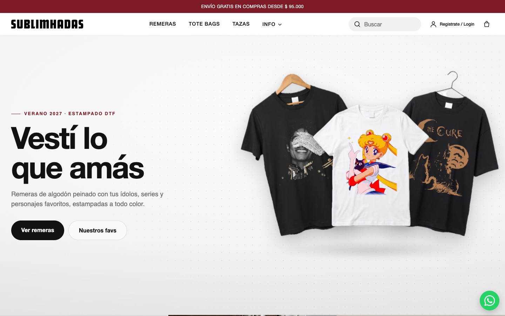
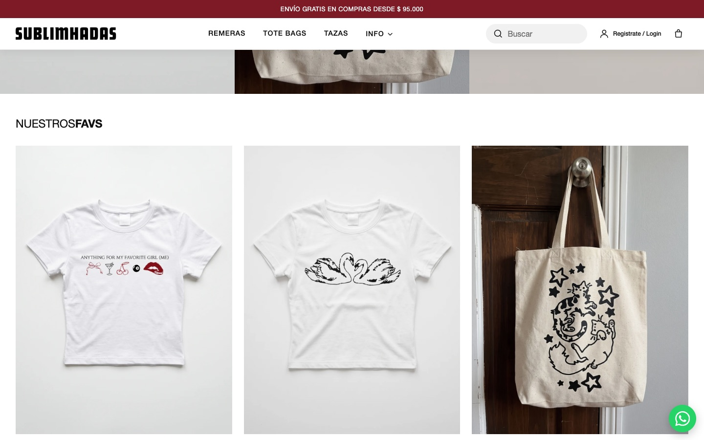
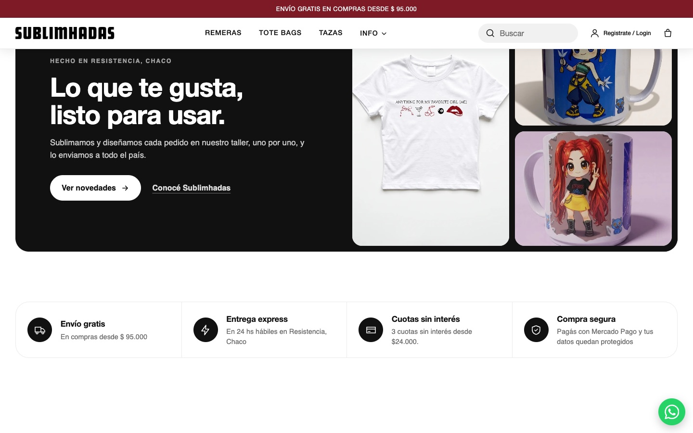
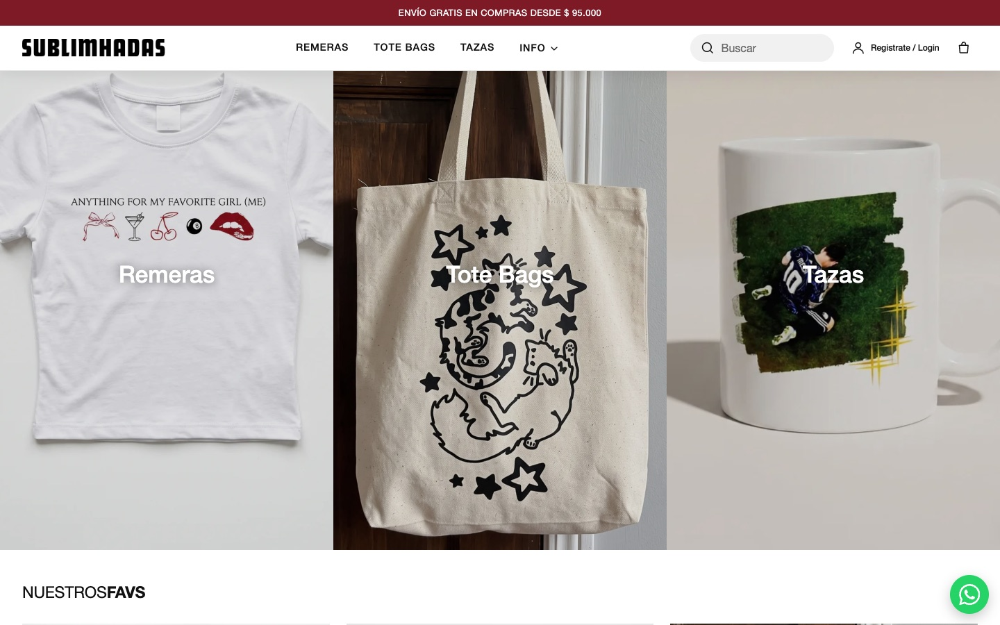
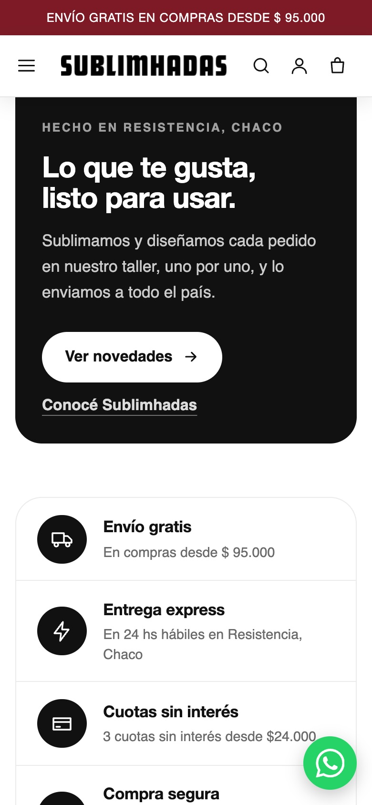
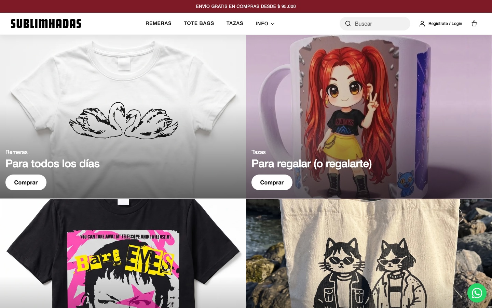

# Sublimhadas — tienda online

Tienda online de **remeras, tote bags y tazas personalizadas**, hecha en Resistencia, Chaco. Frontend y API desarrollados a medida.

**🔗 Demo en vivo: [ecommerce-store.rushdesign.workers.dev](https://ecommerce-store.rushdesign.workers.dev/)**

## Qué incluye
- Portada con campaña de temporada (Verano 2027, estampado DTF), productos favoritos y colecciones de remeras, tote bags y tazas.
- Catálogo por categorías y buscador.
- Cuenta de usuario (registro e inicio de sesión) y carrito.
- Pago con **Mercado Pago**, envíos y cuotas sin interés.
- Beneficios a la vista: envío gratis desde $ 95.000, entrega express en Resistencia y cuotas sin interés.
- Contenido para SEO: guías y artículos de blog (DTF, cuidado de prendas, regalos personalizados).
- Contacto directo por WhatsApp y redes sociales (Instagram, Facebook, TikTok).

<table>
  <tr>
    <td></td>
    <td></td>
  </tr>
  <tr>
    <td></td>
    <td align="center"> </td>
  </tr>
  <tr>
    <td colspan="2"></td>
  </tr>
</table>

## Arquitectura
- **Tienda:** Angular (TypeScript), desplegada en Cloudflare.
- **API:** Hono sobre Deno, PostgreSQL, documentada con OpenAPI. Los tipos del frontend se generan desde esa especificación.
- **Autenticación:** JWT con renovación de sesión (access token en memoria, refresh token aparte).
- **Pagos y emails:** Mercado Pago y Resend.
- **Calidad:** tests con Vitest.

## Nota
El código fuente es privado. Este repositorio muestra el resultado del trabajo.

© 2026 Francisco Montilla. Todos los derechos reservados.
